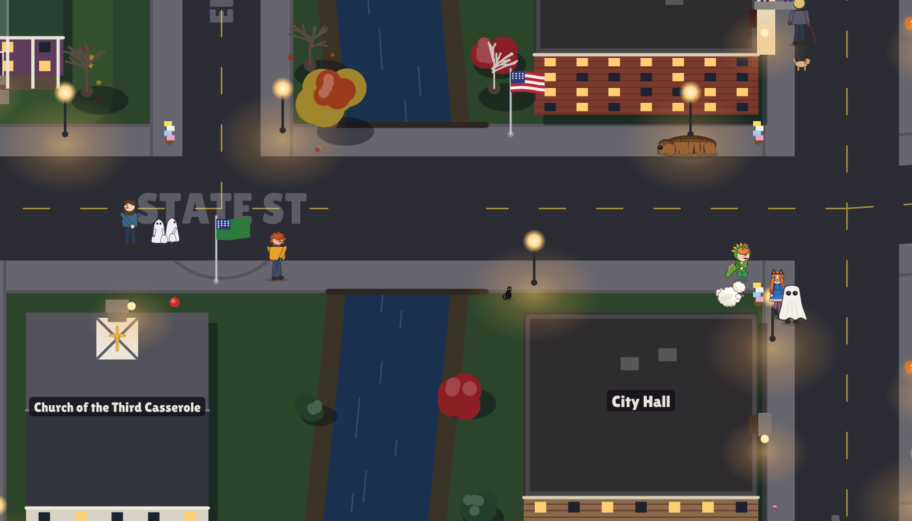
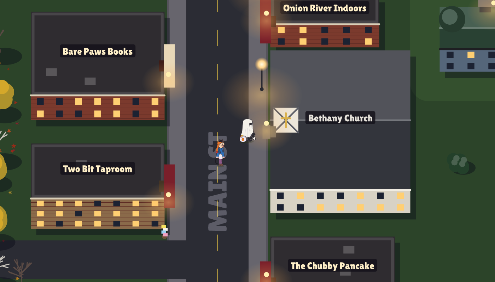
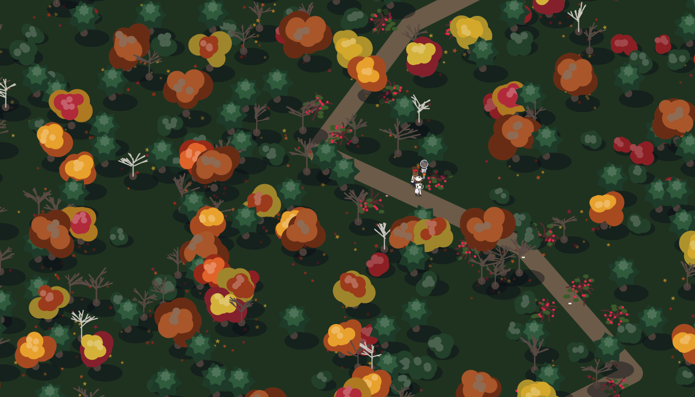
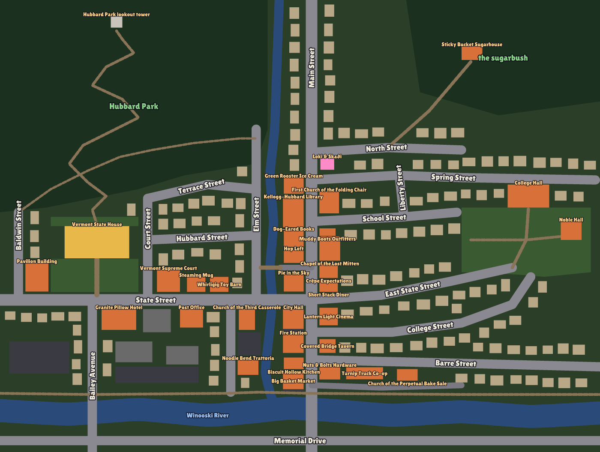

# Silkie Loophole

*Free candy, if you're in costume.*

A raccoon in Montpelier, Vermont has worked out that on Halloween people
hand out free candy to anybody in a costume. It has found a bedsheet. It
has cut two eye holes. Its tail sticks out of the back.

Silkie Loophole is an open-ended exploration game for the terminal, written
in Rust, in the same world as
[Silkie Sprint](https://github.com/adamdeprince/sprint) and
[Silkie Scramble](https://github.com/adamdeprince/scramble). There is no
end: the fun is in finding out what everybody in town does, and what you
can get them to do. The journal keeps count of the odd things you have seen.

It runs in [kitty](https://sw.kovidgoyal.net/kitty/) and in
[Silkie](https://silkie.goblinreactor.com/), a fork of kitty with extra
graphics, input and timing protocols. kitty is fully supported; Silkie makes
it better (see [Terminal support](#terminal-support)).



## The night

**Trick or treat.** Walk up to a door and knock (Space). Whoever answers
looks at you, and decides. A clean, whole sheet passes for a child; a
torn, muddy, wet or smelly one does not, and neither does a raccoon whose
belly has hitched the sheet up past its knees. Some people give generously,
some grudgingly, some give raisins, the dentist gives toothbrushes, one
family gives full-size bars, and a lot of Vermonters give maple. Nearsighted
neighbours give to anybody. Knock twice looking the same and they remember
you; patch the sheet differently and you are a new ghost. Get recognised
and word gets round the street. Bowls run out (the porch light goes off)
and fill up again, each household at its own pace. Shops on Main and State
Streets give candy too, and some give stranger things: at the State House
Calvin Coolidge hands over maple candy and Plymouth Notch cheddar without
a word; at the library Robert Frost answers with a book of his poems, a
verse and a bookmark; the fire station a sticker, City Hall a pamphlet about
composting, the hardware store duct tape.

**Happiness** is the raccoon's energy. Walking wears it down (running
twice as fast, swimming faster still), candy and kindness bring it back,
and the sadder the raccoon the slower it goes: at rock bottom it moves at
less than half speed. A belly rub for Gravy cheers it up too, and hákarl
makes it the happiest raccoon there has ever been.

**Breath** is for running. A raccoon is a sprinter: five seconds flat out
and it is winded (the bar goes red), and it walks until a third of its
breath is back. It gets its wind back walking, and twice as fast standing
still. Running also frays the hem faster and goes through bushes harder.

**The belly.** Eat (E) and the bag opens: choose what (the best is at the
top, and a heart marks the favourites, which make it dance: cheddar,
maple, peanut butter cups, cider donuts, full-size bars). Every piece
fills the belly, and the belly goes down slowly, about a piece every three
quarters of a minute. Half a dozen pieces and it will not take another
bite; nearly full, it waddles; and a round belly hitches the sheet up so
the legs show at the door. The bag just gets bigger (and heavier, and
people start to notice how big).

**The sheet** tears: on bushes, on raspberry canes (the berries count as
candy; the thorns do not care), in falls, in dogs' mouths, when a small boy
pulls your tail, and slowly as the hem drags. Mud and puddles stain it, the
river soaks it (raccoons swim) until you can see the raccoon through it,
and you do not want to know what makes it smell. Patch it (F) with whatever
you find: scraps of paper, napkins, other people's chewing gum, maple
leaves, flyers torn from telephone poles, toilet paper from trees somebody
decorated, your own candy wrappers, and anything the shops gave you.



**Loki and Skaði** think you are another kid and tag along. They keep to
the sidewalks and stop at the curb before they cross. Skaði (fourteen, cat
ears and whiskers over her own blue dress) watches where you are heading,
guesses the door and gets there first; Loki (six, in a dinosaur hoodie with
his pumpkin pail) watches his sister and races her to it. With them along
every child takes one, from the same bowl, so it pays to change course at
the last moment; they notice, and they catch on fast. You can outrun them,
for a while: a raccoon's breath runs out, and they skip to catch up.

Loki runs everywhere, dives into leaf piles, pulls your tail, moves things,
brings you presents, and runs the hen's eggs home on his own and back. When
he crashes into you some of your candy goes on the ground, and round he goes
in a loop to come back for it. He eats out of his pail as he goes, and the
sugar shows (the status line keeps count): the higher it gets, the more he
dashes, the faster he runs, the more often he crashes into somebody (you,
his sister, the hen, anybody on the sidewalk, and they all drop something),
and the wider and sillier the loop before he comes back for it. Skaði makes
him stop if she sees. Too much, and he crashes the other way: he stops dead
and cries, with no idea why, and his sister comes running to hug him. Bump
into him while he is carrying an egg and it breaks, and that is another hug.
Skaði hands back what you drop, patches your sheet, gets the hen out of the
road and puts candy back when you take the whole bowl. If she runs into you
in a hurry, you go down and the candy goes everywhere.

**Giving.** E opens the bag to choose what to eat; G, what to hand to
whoever is in reach (the night waits while you choose). Everybody takes
things differently. Feed Loki chocolate and stand back: the sugar sends
him careering into people, and what they drop is yours if you get there
before he loops back for it. Cheddar calms him down; caramel glues his
teeth shut for a bit; a lollipop keeps him content; he will tell you that
an apple is not candy. Something good bribes Skaði into not noticing you
empty a bowl. Feed the hen (candy corn, ideally) and she is on your heels
for a while, and lays sooner, and Loki sprints the egg home and back,
which leaves you without your human bowling ball for a bit. Gravy loves
cheddar more than a belly rub and will not touch chocolate. The black cat
only wants cheese, and a fed cat crosses nobody's path. And hákarl: Loki,
Skaði, the hen and the cat love it, but offer it to anybody else and they
recoil and run, dropping candy; offer it at a door and the householder
flees indoors and the bowl goes over on the step, with nobody watching.
Carrying it frightens nobody. Offering it is the thing.

**Gullinkombi**, the hen, goes where the children go and does whatever she
likes. Content, she pecks about and sits down exactly where you were going.
Peckish, she notices candy near her (and in your bag). Hungry, she will
cross the street for it. Full, she lays eggs and leaves droppings. Do not
slip in them. The children love her, and when both of them pick her up at
once it is a tug of war.

**Their mother** answers the door of their house on the corner of Main and
North Streets, dressed as a jug of maple syrup, with a platter of hákarl
(her grandmother's recipe). The other children run from it, screaming.
The raccoon, Loki and Skaði think it is the best thing in the world.

**Gravy** is a very big, very slow brown dog with a coat that hangs in
cords, who lives around State and Main. He lies down where you want to go
and does not get up until somebody rubs his belly (Space). He also eats any
candy he finds, and it does not agree with him. Watch where you step.

**The black cat** on State Street crosses your path on purpose (bad luck
at the next door), hisses at a shabby costume, and ignores Skaði's cat
ears completely.

**Everybody else**: most of the people out are other trick-or-treaters,
with their families or in bands of older kids, emptying the same bowls you
want. A badly kept costume frightens them, and frightened children drop
candy as they run. Finders keepers. Teenagers levy a Halloween tax on big
bags. There are dog walkers whose dogs are not fooled, joggers, leaf
peepers with cameras, professors from the college who think you are a
performance piece, a legislator with views on the Republic of Vermont,
maple farmers, and the neighbours, friendly or suspicious or oblivious.

**The town** is Montpelier, from the State House to the college, between the
hills on both sides of Main Street down to the Winooski River: the gold
dome, the Kellogg-Hubbard Library, City Hall and the fire station, the
Chapel of the Lost Mitten, the North Branch and the Langdon Street footbridge, the bike
path, the co-op on Stone Cutters Way, painted cows, flags (and a few Green
Mountain Boys flags) on State Street, and a Main Street of made-up shops
(Dog-Eared Books, the Hop Loft, Pie in the Sky, the Lantern Light Cinema,
Green Rooster Ice Cream, Nuts & Bolts Hardware...). Behind the State
House a trail climbs through Hubbard Park, lined with raspberry canes, to
the stone lookout tower. Somebody is up there.



*Silkie Loophole is a work of fiction and gentle parody. The shops,
restaurants, hotels and churches in it are invented, with invented names;
none of them stands for a real business or congregation, and nothing here
is meant to say anything about any real business, congregation or person.
Public places (the State House, the library, City Hall, the fire station,
the college) appear as themselves, affectionately. The game is not affiliated with or endorsed by
the City of Montpelier, the State of Vermont or anybody else in it.*

The evening runs from half past five to half past nine. Then it is
Halloween again.



### The status line

| | |
|---|---|
| bag | pieces in the bag, and what they are worth |
| happy | happiness: how fast the raccoon goes |
| breath | how much running is left; red when winded |
| belly | how full it is |
| sheet | how well the raccoon passes for a child right now: tears, mud, wet, smell and belly all count |
| mend | things to patch the sheet with |
| loki | pieces in Loki's pail |
| sugar | Loki's blood sugar; red when he is on a rush |

### Controls

| key | action |
|---|---|
| arrows, WASD | walk |
| Shift (hold), or R (toggle) | run |
| Space, Enter | knock / take / rub a belly / patch |
| E | pick something from the bag to eat |
| G | pick something to give whoever is in reach |
| in that menu | ↑/↓ (or W/S) and Enter, or 1-9; any other key backs out |
| F | patch the sheet |
| click, pen or finger | walk there |
| right click | as Space |
| M, Tab, or a pinch (Silkie trackpad) | the town map |
| J | the journal of discoveries |
| + / - | zoom |
| ?, H, F1 | how to play |
| P, Esc | pause |
| F2 or ` | diagnostics |
| Ctrl+Z | suspend (`fg` resumes) |
| Ctrl+C | quit |

## Terminal support

The game needs a terminal that implements the
[kitty graphics protocol](https://sw.kovidgoyal.net/kitty/graphics-protocol/).
Every feature is detected by asking the terminal at start-up, never by its
name; `silkie-loophole --report` prints what your terminal answered.

The rules, the town and everybody in it are identical everywhere. What
Silkie adds is presentation, input and bandwidth:

| | kitty | Silkie |
|---|---|---|
| The town | rasterized here in chunks around the camera and sent as pixels | vector images (`f=200`) the terminal draws: a chunk is a few kilobytes of records instead of a picture |
| A porch light going out, berries picked, a leaf pile scattered | the chunk is drawn and sent again | a patch of a few records |
| Candles and flags | still | jack-o'-lanterns flicker and flags ripple, by patches |
| Sprites | sprite sheets sent as pixels | the same sheets as vector images, painted by the terminal; the raccoon's costume changes are a new small scene, not a bitmap |
| Glow | | porch lights, candle flames, streetlights and the gold dome brighter than white on HDR displays |
| Map | bitmap of the town | vector map, crisp at any size |
| Memory in the terminal | pixels, kept under kitty's 320 MB image quota (on very large high-density windows tiles are drawn at most 96 pixels) | a few megabytes of records |
| Frame pacing | timer | presentation reports from the terminal |
| Input latency | normal | low-latency mode while playing |
| Taps | mouse | mouse, pen or touchscreen |
| Gestures | | pinch for the town map, smart zoom to toggle it |
| Menus and speech bubbles | opaque | translucent over the town |
| Feedback | | trackpad haptics: knocks, candy, falls, tears, discoveries |
| Display | | refresh rate, pixel scale and e-ink awareness |

Run with `--kitty-only` in Silkie to see the game as kitty shows it.

Inside tmux or screen the graphics protocol needs passthrough, which the game
does not attempt; run it directly in the terminal. Over SSH, images travel
inside the terminal stream (locally they go through temporary files); on
kitty a new part of town takes a moment to arrive over a slow link, on
Silkie much less.

## Installing

You need Rust (stable, 1.85 or newer) and Cargo.

```sh
cd silkie-loophole
cargo build --release
./target/release/silkie-loophole
```

or `cargo install --path .`. A big window with a small font gives the town
the most pixels.

### Options

```
--seed N            the same seed and the same inputs make the same night
--town FILE         play in another town (see assets/town/README.md)
--autoplay          let the raccoon go door to door by itself
--diagnostics       show the diagnostics panel (F2 toggles)
--kitty-only        use only what plain kitty offers
--no-vector, --no-latency, --no-frame-feedback, --no-haptics, --no-hdr
                    turn off individual Silkie features
--no-tempfile       send images inline even when files would work (as over SSH)
--report            print the terminal's capabilities and exit
--log FILE          log to a file
```

Subcommands that need no terminal:

```sh
silkie-loophole headless --seconds 600       # the raccoon plays itself; how it went
silkie-loophole snapshot --at 30 out.png     # a picture of a moment of play
silkie-loophole town [FILE]                  # check a town file
```

The journal is kept in `~/Library/Application Support/com.goblinreactor.silkie-loophole/`
on macOS, and in `$XDG_DATA_HOME/silkie-loophole/` (by default
`~/.local/share/silkie-loophole/`) elsewhere.

## Development

```sh
cargo test
cargo clippy --all-targets
cargo run --release --example preview_sheet -- raccoon 96 raccoon.png worn
cargo run --release --example town_view -- 20 90 64 46 22 statehouse.png
```

* [docs/TECHNICAL.md](docs/TECHNICAL.md): how it works.
* [assets/town/README.md](assets/town/README.md): the town file.
* [assets/PROVENANCE.md](assets/PROVENANCE.md): where the art and typeface
  come from.

The pictures in this README were made by `silkie-loophole snapshot` (and
the map by `cargo run --release --example map_view`), which composite the
same scenery and sprite sheets the terminal is sent.

The town is drawn from memory and simplified. If you know Montpelier and
something is in the wrong place, it is a line in `assets/town/montpelier.txt`.

## License

Copyright 2026 Adam DePrince. Licensed under the
[Apache License, Version 2.0](LICENSE); see [NOTICE](NOTICE). The Lilita One
typeface in `assets/fonts/` is under the SIL Open Font License 1.1
([OFL.txt](assets/fonts/OFL.txt)).
